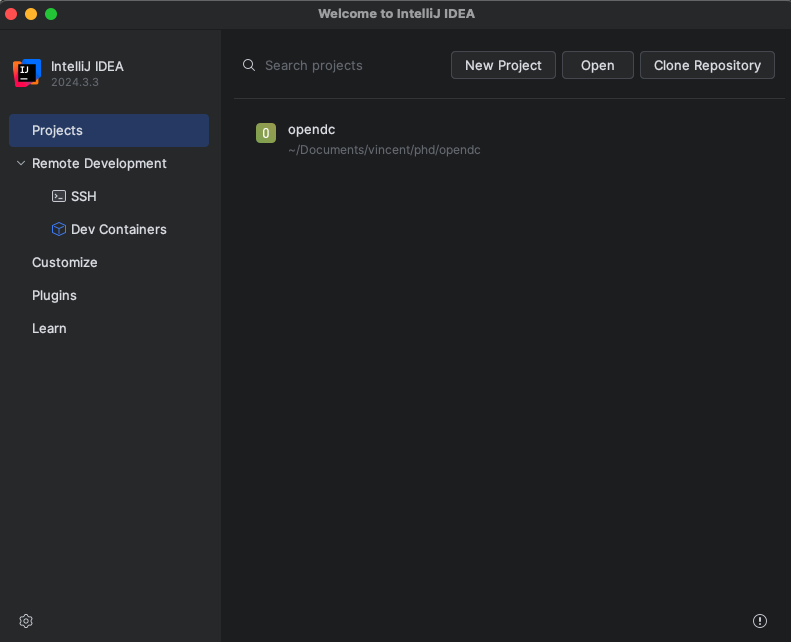
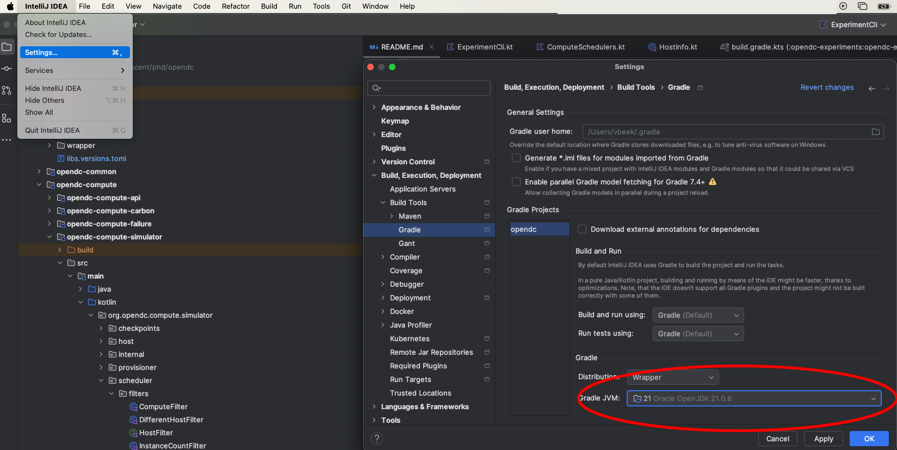
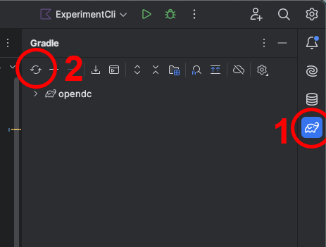

# Developing with IntelliJ

[IntelliJ IDEA](https://www.jetbrains.com/idea/) runs OpenDC from its source code, which is the most direct way to
change OpenDC or to debug an experiment. This page explains how to set up the project and how to run an experiment
from source.

## Setting up the project

1. Clone the repository:

    ``` bash
    git clone https://github.com/atlarge-research/opendc.git
    ```

2. Make sure that Java&nbsp;21 is installed. The following commands list the installed versions:

    | System        | Command                                |
    |---------------|----------------------------------------|
    | macOS         | `/usr/libexec/java_home -V`            |
    | Debian/Ubuntu | `update-alternatives --list java`      |
    | Red Hat       | `yum list installed \| grep java`      |

3. Open the folder `opendc` in IntelliJ. IntelliJ imports it as a Gradle project.

    

4. Set the Java version that Gradle uses. In the settings, go to **Build, Execution, Deployment** → **Build Tools**
   → **Gradle**, and set **Gradle JVM** to Java&nbsp;21.

    

5. Open the Gradle panel on the right (1) and reload the project (2).

    

## Running an experiment from source

The entry point of the [`opendc`](../reference/cli.md) command is the function `main` in
`opendc-cli/src/main/kotlin/org/opendc/cli/Main.kt`. To run it with an experiment:

1. Open `Main.kt`.
2. Click the run arrow next to `fun main` and choose **Modify Run Configuration...**.
3. Set **Program arguments** to the command to run, such as `run experiment.json --no-progress`.
4. Set **Working directory** to the folder with the experiment files.
5. Run the configuration, or start it in debug mode to use breakpoints.

`--no-progress` turns off the dashboard, which the console of IntelliJ does not display well.

## Code style in the editor

The build checks the code style with Spotless, as [Building and Testing](building.md#code-style) describes. To apply
the style from IntelliJ, run the Gradle task `spotlessApply` from the Gradle panel before committing.
