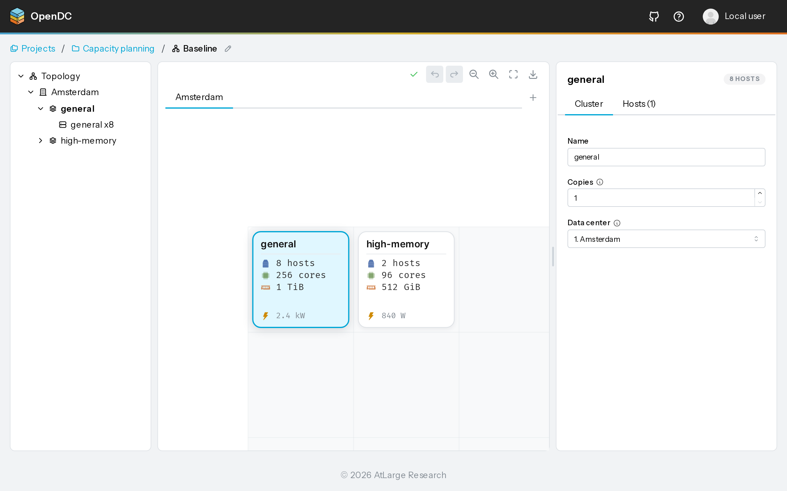
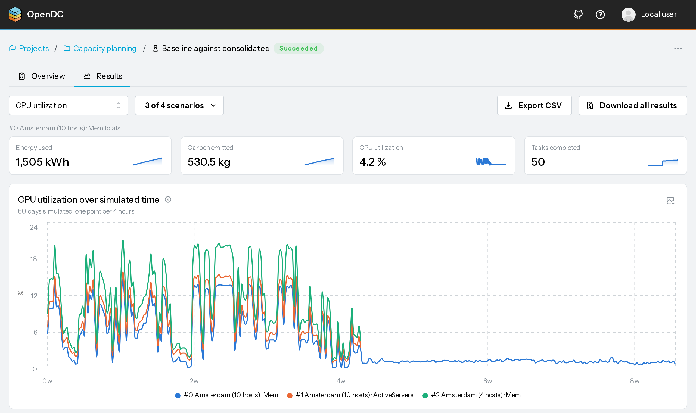

# Introduction

OpenDC is a free and open-source platform for simulating cloud datacenters, aimed at both research and education. With
OpenDC, we describe the design of a datacenter, the workload it serves and the policies that operate it, and simulate
how they perform together. The simulator reports resource use, energy use and carbon emissions over time, which makes
OpenDC suitable for studying questions such as how many machines a workload needs, or how much carbon a scheduling
policy saves.

/// figure-caption
Designing a datacenter in the web application.
///

/// figure-caption
Comparing the scenarios of an experiment.
///

A study in OpenDC is an *experiment*: a set of datacenter designs, workloads and policies to compare. OpenDC simulates
every combination of them, each of which is called a *scenario*. Figure 1 shows the design of one datacenter, and
Figure 2 the results of an experiment with four scenarios. An experiment can also explore phenomena that are costly to
try on real hardware, such as machine failures or the use of batteries.

## Ways to use OpenDC

OpenDC has four entry points. All of them accept the same description of an experiment and use the same simulator, so
an experiment can move from one to another.

-   :lucide-terminal:{ .lg .middle } **Command line**

    ---

    Write an experiment as a JSON file and simulate it with the `opendc` command.

    [:octicons-arrow-right-24: Run a first experiment](getting-started/first-experiment.md)

-   :lucide-layout-dashboard:{ .lg .middle } **Web application**

    ---

    Design datacenters and compare scenarios in the browser, alone or as a team.

    [:octicons-arrow-right-24: OpenDC as a service](web/index.md)

-   :lucide-notebook-pen:{ .lg .middle } **Python**

    ---

    Build experiments in Python and receive the results as pandas DataFrames.

    [:octicons-arrow-right-24: Python SDK](python-sdk/index.md)

-   :lucide-braces:{ .lg .middle } **Kotlin and Java**

    ---

    Embed the simulator in a program on the Java virtual machine.

    [:octicons-arrow-right-24: Kotlin SDK](kotlin-sdk/index.md)

[Entry Points and Use Cases](getting-started/entry-points.md) compares the four and helps to choose between them.

OpenDC is available in two forms. A hosted deployment of the web application runs at
[app.opendc.org](https://app.opendc.org). The source code of all entry points is in the
[OpenDC repository](https://github.com/atlarge-research/opendc), to run on a local machine or with Docker.

## Learning more

The design of OpenDC and the research behind it are described in three papers:

- the [vision](https://atlarge-research.com/pdfs/opendc-vision17ispdc_cr.pdf) that started the project;
- the paper on [OpenDC 2.0](https://atlarge-research.com/pdfs/ccgrid21-opendc-paper.pdf);
- [OpenDC-STEAM](https://atlarge-research.com/pdfs/2026-ccgrid-steam.pdf), a more recent study that uses OpenDC.

The [opendc-demos](https://github.com/atlarge-research/opendc-demos) repository provides tutorials with example
experiments and traces.

## OpenDC versions

This documentation describes OpenDC&nbsp;3, the version in active development. Its latest state is on the `master`
branch of the [OpenDC repository](https://github.com/atlarge-research/opendc).

OpenDC&nbsp;2 is no longer developed. It is maintained on the
[`OpenDC2-maintenance`](https://github.com/atlarge-research/opendc/tree/OpenDC2-maintenance) branch, and
[OpenDC 2 Documentation](opendc-2/index.md) describes it. OpenDC&nbsp;3 still runs most experiment files of
OpenDC&nbsp;2 with `opendc --legacy run`. [Migrating to OpenDC 3](opendc-2/migrating.md) explains how to convert an
experiment.
