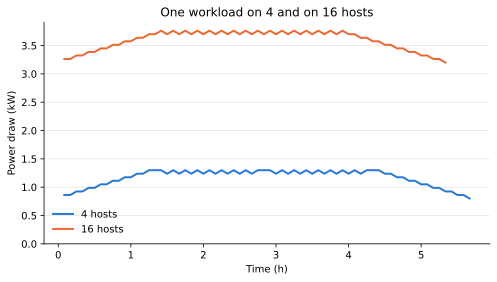

# Python SDK

The Python software development kit (SDK) builds OpenDC experiments in Python, simulates them in the Python process or
on an OpenDC server, and returns every table that they export as a pandas DataFrame. It suits notebooks and analysis
scripts, in which the description of an experiment, its simulation and the analysis of its results form one program.
This page gives an overview of the SDK, explains how to install it, and walks through a complete example.

## Overview

The package is called `opendc-sdk` and is imported as `opendc`. It is a thin layer over the
[Kotlin SDK](../kotlin-sdk/index.md): the classes that describe an experiment are the classes of the Kotlin SDK, and
the simulator is the same. The package has the following parts:

| Name                                                | Role                                                                    |
|-----------------------------------------------------|-------------------------------------------------------------------------|
| `opendc.ExperimentSpec`, `opendc.HostSpec`, ...     | the classes of the Kotlin SDK, with named and default arguments         |
| `opendc.experiment()`, `opendc.topology()`, ...     | builders that mirror the builders of the Kotlin SDK in `with` blocks    |
| `opendc.WorkloadTrace`, `CarbonTrace`, `FailureTrace` | traces as DataFrames or Parquet files                                 |
| `opendc.simulate()`                                 | simulates in the Python process                                         |
| `opendc.Server`                                     | simulates on an OpenDC server                                           |
| `opendc.SimulationResults`                          | the exported tables, one DataFrame each                                 |

The remaining pages of this section describe the parts in turn: [building experiments](specs.md),
[traces](traces.md), [results](results.md), [running on a server](server.md) and the
[internals](internals.md) of the SDK.

## Installation

The SDK needs Python&nbsp;3.11 or newer and Java&nbsp;21 or newer. It finds Java through the environment variable
`JAVA_HOME`. Releases of OpenDC publish the package to the Python Package Index:

``` bash
pip install opendc-sdk
```

The package bundles the Java libraries of the simulator, so it is about 47&nbsp;MiB in size and works without a
network connection.

!!! note "Before the first release of OpenDC 3"

    OpenDC&nbsp;3 has not been released yet, so the Python Package Index does not hold the package. Until it does,
    build the package from a checkout of the [repository](https://github.com/atlarge-research/opendc). The build needs
    [uv](https://docs.astral.sh/uv/) in addition to Java:

    ``` bash
    ./gradlew :opendc-sdk:opendc-sdk-python:uvBuild
    pip install opendc-sdk/opendc-sdk-python/build/distributions/opendc_sdk-*.whl
    ```

## A complete example

The following program answers a small capacity question: how does the power draw of a workload change when it runs on
16&nbsp;hosts instead of 4? It describes both topologies in one experiment, simulates the experiment and plots the
result. Besides the SDK, it needs matplotlib.

``` python title="power.py"
import matplotlib.pyplot as plt

import opendc
from opendc import ghz, gib, minutes

HOST_COUNTS = [4, 16]
COLORS = ["#2a78d6", "#eb6834"]

with opendc.experiment() as experiment:  # (1)!
    for host_count in HOST_COUNTS:
        with experiment.topology() as topology:  # (2)!
            with topology.datacenter() as datacenter:
                with datacenter.cluster() as cluster:
                    with cluster.host(count=host_count) as host:
                        host.cpu(core_count=16, core_speed=ghz(2.4))  # (3)!
                        host.memory(size=gib(64))

    with experiment.workload() as workload:
        for task_id in range(24):
            with workload.task(
                id=task_id,
                submission_time=minutes(10 * task_id),
                duration=minutes(90),
                cpu_core_count=8,
                cpu_capacity=ghz(16),
                memory=gib(16),
            ) as task:
                task.fragment(duration=minutes(90), cpu_usage=ghz(12))

results = opendc.simulate(experiment)  # (4)!

power = results.power_source.pivot_table(  # (5)!
    index="timestamp", columns="scenario", values="power_draw"
)
hours = power.index / 3_600_000

fig, ax = plt.subplots(figsize=(8, 4))
for scenario, host_count, color in zip(power.columns, HOST_COUNTS, COLORS):
    ax.plot(hours, power[scenario] / 1000, label=f"{host_count} hosts", color=color, linewidth=2)
ax.set_ylim(bottom=0)
ax.grid(axis="y", color="#e6e6e3")
ax.spines[["top", "right"]].set_visible(False)
ax.legend(frameon=False)
ax.set(xlabel="Time (h)", ylabel="Power draw (kW)", title="One workload on 4 and on 16 hosts")
fig.savefig("power.svg", bbox_inches="tight")
```

1.  A `with` block builds one part of the experiment. The block takes the place of a JSON object in an
    [experiment file](../reference/experiment/index.md).
2.  Each pass of the loop adds one topology. The experiment has two topologies and one workload, and therefore two
    scenarios.
3.  Quantities carry their unit: `ghz(2.4)` is a frequency, `gib(64)` a data size.
4.  `simulate` validates the experiment, simulates every scenario and returns the exported tables.
5.  `results.power_source` is the table [`powerSource.parquet`](../reference/output/energy.md#powersourceparquet) of
    all runs, as one DataFrame. Its column `scenario` tells the two topologies apart, and its timestamps are in
    milliseconds since the start of the simulation.

Figure 1 shows the plot that the program writes.



/// figure-caption
The power draw of one workload on 4 and on 16&nbsp;hosts, as plotted by the example.
///

The 16&nbsp;hosts draw about three times the power of the 4&nbsp;hosts, most of which is idle power, yet they finish
the workload only about 20&nbsp;minutes sooner. Over the whole run, they use 19.3&nbsp;kWh against 6.8&nbsp;kWh.
