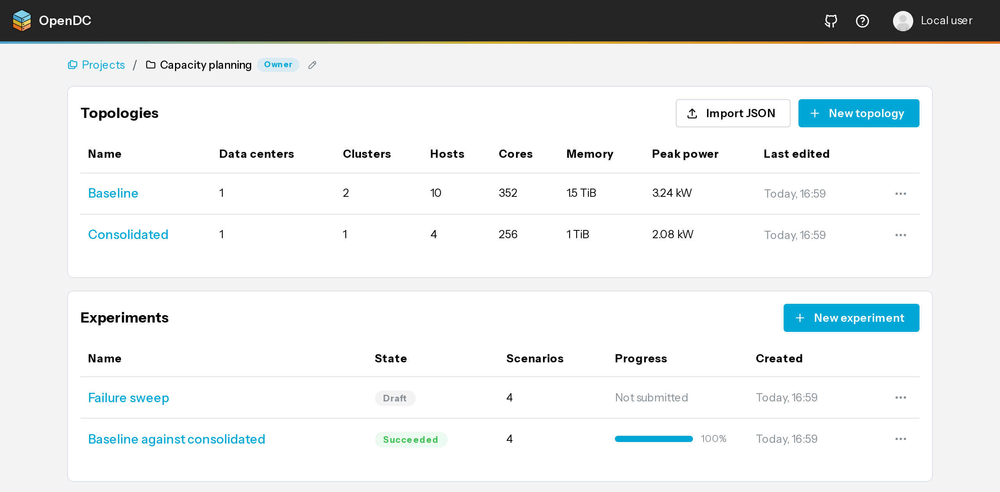
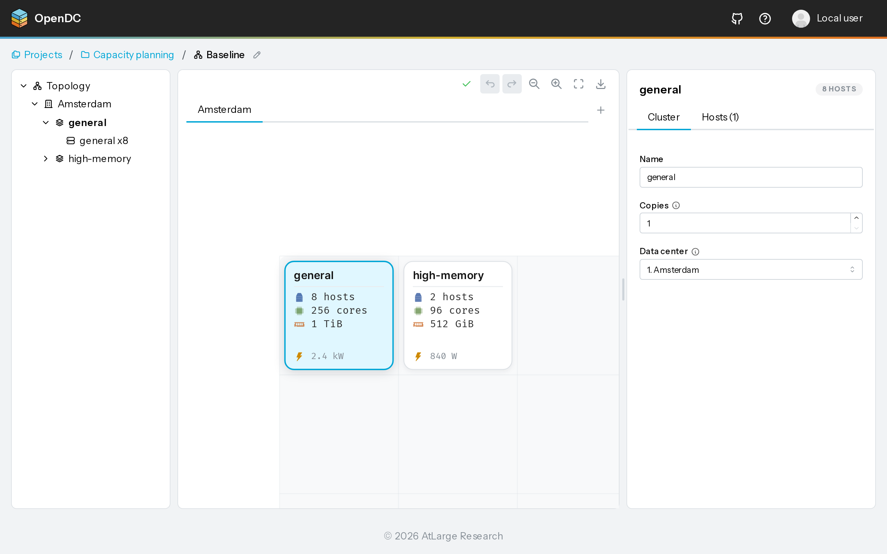
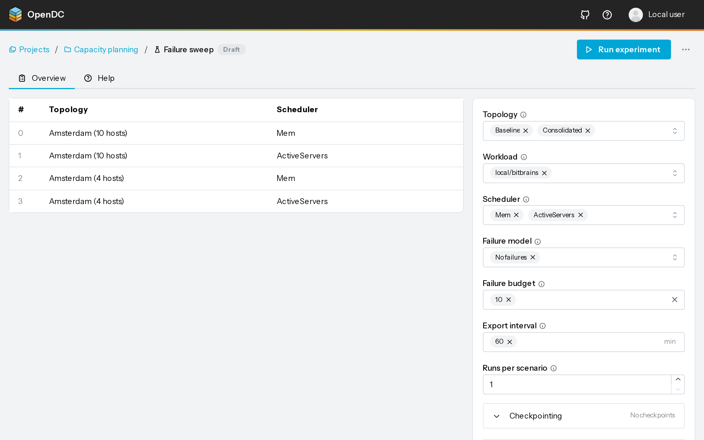
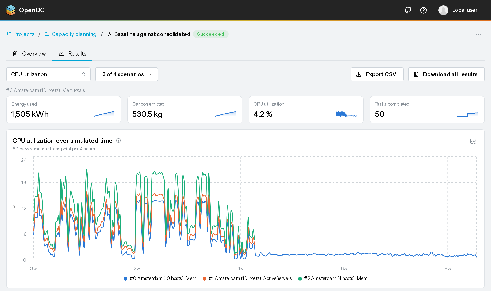
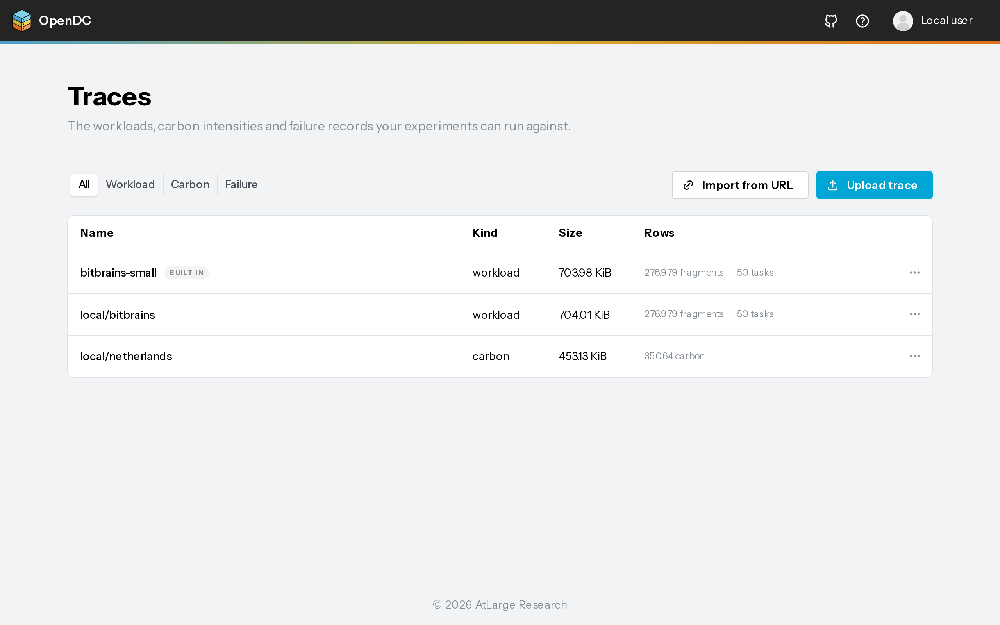

# Using the Web Application

This page walks through the web application in the order a first experiment needs it: we sign in, create a project,
design a topology, run an experiment and read its results. The last two sections cover the trace library and the
account settings.

## Signing in

How we sign in depends on the deployment. A deployment in *anonymous mode* signs nobody in: every visitor acts as one
account, called **Local user**, which is how a deployment for a single person works. Any other deployment shows
**Sign in** and takes us to its sign-in provider.

The first sign-in asks for a *handle* and a display name. The handle consists of 3 to 32 lower-case letters, digits or
dashes, and starts with a letter. It prefixes the names of the traces we upload, as in `alice/nightly`, and is what
others type to add us to a project. The handle is fixed once the account owns a trace.

## Projects

The start page lists the projects we are a member of. **Create project** adds one and opens it. The filter above the
list separates the projects we own from those shared with us.

A project page (Figure 1) has two panels: the topologies of the project and its experiments.

/// figure-caption
A project page. The upper panel lists the saved topologies, the lower panel the experiments and their progress.
///

Every member of a project has one of three roles:

| Role       | May                                                                                           |
|------------|-----------------------------------------------------------------------------------------------|
| **Viewer** | read topologies, experiments and results, and download them                                   |
| **Editor** | also create, change and delete topologies and experiments, and run, stop and retry experiments |
| **Owner**  | also add and remove members, change their roles, and delete the project                       |

The menu of a project card opens **Members**. An owner adds a member by handle and picks the role. A project always
keeps at least one owner. Any other member can leave a project with **Leave**.

## Topologies

**New topology** creates an empty topology and opens the editor. **Import JSON** creates a topology from a file that
holds a [topology](../reference/experiment/topology/index.md) in the format of the experiment file. The menu of a
topology row duplicates, downloads or deletes it. Deleting a topology does not affect experiments that were already
submitted, because each experiment stores its own copy.

The editor (Figure 2) shows one topology in three panes. The tree on the left lists the datacenters, their clusters and
the host groups of each cluster. The floor plan in the centre shows the clusters of one datacenter as tiles. The
inspector on the right edits whatever is selected.

/// figure-caption
The topology editor. A cluster tile summarises its hosts, cores, memory and peak power draw.
///

We build a topology on the floor plan:

| Action                                   | Effect                                         |
|------------------------------------------|------------------------------------------------|
| click an empty tile                      | adds a cluster there                           |
| drag a cluster                           | moves it, or swaps two clusters                |
| double-click a cluster                   | opens its host groups in the inspector         |
| ++shift++ and click                      | selects several clusters                       |
| ++ctrl+d++                               | duplicates the selection                       |
| ++delete++                               | removes the selection                          |
| ++ctrl+z++, ++ctrl+shift+z++             | undoes or redoes a change                      |
| ++ctrl+s++                               | saves at once                                  |

On macOS, ++cmd++ takes the place of ++ctrl++. The tabs above the floor plan switch between datacenters, and **+** adds
one.

What the inspector edits depends on the selection:

- With nothing selected, it shows the totals of the topology and lists its problems.
- For a datacenter, the **Power** tab limits the power supply and selects a carbon trace from the trace library. The
  **Battery** tab attaches a [battery](../reference/experiment/topology/battery.md) and sets its policy.
- For a cluster, the **Cluster** tab sets its name, the number of copies and its datacenter. The **Hosts** tab lists
  its *host groups*. A host group is a number of identical hosts, and starts from one of the host templates of the
  deployment.
- For a host group, the inspector edits the CPU, memory and GPU of its hosts and their
  [power models](../reference/experiment/topology/power-model.md).

The editor saves a change about a second after we make it, and the toolbar shows whether all changes are saved. It also
checks the topology with the rules of the simulator and marks each problem with a red triangle. A topology with
problems is still saved, but an experiment that uses it cannot run.

The editor has no form for some fields of a topology: the
[distribution policies](../reference/experiment/topology/distribution-policy.md), the
[virtualisation overhead](../reference/experiment/topology/virtualization-overhead.md) of a GPU, inline carbon traces,
and the initial charge, embodied carbon and expected lifetime of a battery.

## Experiments

**New experiment** asks for a name and creates a draft. The button needs at least one topology in the project. The draft
starts with the first topology of the project and the built-in workload trace `bitbrains-small`.

### Editing a draft

The **Overview** tab of a draft (Figure 3) shows the settings on the right and the resulting scenarios on the left.
Most settings accept several values. As in an [experiment file](../reference/experiment/index.md#scenarios), the
experiment has one scenario for each combination of values.

/// figure-caption
A draft with two topologies and two schedulers, which give four scenarios.
///

Each setting corresponds to a field of the experiment document:

| Setting               | Field of the experiment document                                                   | Values                                          |
|-----------------------|------------------------------------------------------------------------------------|-------------------------------------------------|
| **Topology**          | `topologies`                                                                       | the saved topologies of the project             |
| **Workload**          | `workloads`                                                                        | the workload traces of the trace library        |
| **Scheduler**         | `allocationPolicies`                                                               | the [prefabs](../reference/experiment/allocation-policy.md#prefabs) |
| **Failure model**     | `failureModels`                                                                    | no failures, or a [prefab](../reference/experiment/failure-model.md#prefab-models) |
| **Failure budget**    | `maxNumFailures`                                                                   | whole numbers from 1                            |
| **Export interval**   | `exportInterval` of `exportModels`                                                 | minutes                                         |
| **Runs per scenario** | `runs`                                                                             | 1 to 32                                         |
| **Checkpointing**     | `checkpointModels`                                                                 | no checkpointing, or interval, duration and scaling |

The footer of the settings states the number of scenarios and an estimate of the simulation budget the experiment
reserves. The **Help** tab explains how the settings multiply into scenarios and runs.

The draft editor covers the settings a typical study varies. It has no form for inline workloads, the sampling and
scaling options of a trace workload, filter policies, custom and trace-based failure models, the selection of exported
files and columns, and the initial seed. An experiment needs the command-line interface or an SDK for these.

### Running an experiment

**Run experiment** states the number of scenarios and the budget they reserve, and asks for confirmation. Once
submitted, the experiment is frozen: its settings can no longer change. **Clone to draft** in the menu of the page
creates an editable copy.

The **Overview** tab now reports progress as the number of tasks simulated, and the state of each scenario. Table 1
lists the states of an experiment.

| State         | Meaning                                                               |
|---------------|-----------------------------------------------------------------------|
| **Draft**     | not submitted yet                                                     |
| **Queued**    | submitted, and no run has started                                     |
| **Running**   | at least one run has started, and at least one has not ended          |
| **Succeeded** | every run succeeded                                                   |
| **Partial**   | every run ended, some succeeded and some did not                      |
| **Failed**    | every run ended, and none succeeded                                   |
| **Cancelled** | every run was cancelled                                               |

/// table-caption
The states of an experiment.
///

A click on the number of a scenario opens its details: the state of each run, the attempts the server made, the output
files and the log of the simulation. The refresh icon of a finished scenario runs that scenario again.

**Stop** cancels the runs that have not ended. Scenarios that already finished keep their results. **Delete** removes an
experiment together with its results.

### Reading the results

The **Results** tab (Figure 4) charts one metric at a time. The tiles at the top give the totals of the first selected
scenario. The line chart plots the metric over simulated time, with one line per selected scenario. With more than one
scenario, a bar chart below it compares all scenarios by one number each.

/// figure-caption
The results of an experiment. The line chart overlays up to three scenarios.
///

The metric selector offers the metrics that the runs reported, out of the following twelve:

| Metric                        | Derived from the [output file](../reference/output/index.md) |
|-------------------------------|---------------------------------------------------------------|
| CPU utilization               | `cpu_usage` of `host.parquet`, as a share of the CPU capacity |
| IT power draw                 | `power_draw` of `host.parquet`                                |
| Facility power draw           | `power_draw` of `powerSource.parquet`                         |
| Energy used                   | `energy_usage` of `powerSource.parquet`                       |
| Carbon emitted                | `carbon_emission` of `powerSource.parquet`                    |
| Carbon intensity              | `carbon_emission` per `energy_usage` of `powerSource.parquet` |
| Tasks running                 | `tasks_active` of `service.parquet`                           |
| Tasks queued                  | `tasks_pending` of `service.parquet`                          |
| Tasks completed               | `tasks_completed` of `service.parquet`                        |
| Tasks terminated              | `tasks_terminated` of `service.parquet`                       |
| Hosts down                    | `hosts_down` of `service.parquet`                             |
| Battery charge                | `charge` of `battery.parquet`                                 |

The charts are available while an experiment runs. During a run they show the samples that the launcher reports, which
are a preview. After a run they show its output files.

Three buttons take the results out of the browser:

- **Save as PNG** stores one chart as an image.
- **Export CSV** stores the plotted series, with one row per scenario and point in time.
- **Download all results** stores a zip archive with the output files of every successful run. The archive has the
  [folder layout](../reference/output/index.md#where-the-results-are-written) of a local run, so analysis scripts work
  on both.

## Traces

**Traces** in the account menu opens the trace library (Figure 5). It lists the workload, carbon and failure traces the
account may use, with the built-in traces of the deployment first.

/// figure-caption
The trace library. The traces of an account carry its handle, here `local`.
///

**Upload trace** adds a trace from Parquet files. We choose the kind, a name and one file per table:

| Kind     | Files                               | Format                                                                    |
|----------|-------------------------------------|---------------------------------------------------------------------------|
| Workload | `tasks.parquet`, `fragments.parquet` | [Workload traces](../reference/experiment/workload.md#workload-traces)    |
| Carbon   | `carbon.parquet`                    | [Carbon traces](../reference/experiment/topology/power-source.md#carbon-traces) |
| Failure  | `failures.parquet`                  | [Failure traces](../reference/experiment/failure-model.md#failure-traces) |

A trace name consists of lower-case letters, digits, dots, dashes and underscores, and starts with a letter or a
digit. The library lists the trace as `<handle>/<name>`, which is also the name an experiment document uses to
reference it.

**Import from URL** adds a trace that the server downloads itself, from one public `http` or `https` address per
table. This suits traces that are too large to pass through a browser. The page reports the progress of each import.

The menu of a trace we own offers four actions:

- **Edit** changes its name and description.
- **Share** gives another account access by handle. A shared trace appears in the library of that account.
- **Download** stores the tables as a zip archive.
- **Delete** removes the trace. The server refuses to delete or rename a trace that a submitted experiment references.

## Account

The account button in the header opens the account menu. It shows the handle, the plan of the account and its
*simulation budget*: the simulation time the account may still use in the current session of 5&nbsp;hours and in the
current week. [Operations](operations.md#plans-and-budgets) explains how the server counts this time.

**Profile** changes the display name and the handle, and **Dark mode** switches the colours of the application. In a
deployment that signs people in, the menu has two more entries:

- **Access tokens** creates tokens for scripts. A token is shown once, when we create it. The command-line interface
  reads it from `OPENDC_TOKEN` or `--token`, and the Python SDK from `OPENDC_TOKEN` or the `token` argument.
- **Deactivate account** closes the account for good. Its tokens stop working and it leaves the projects of others.
  Nothing is deleted.

Administrators also see **Admin panel**, which [Operations](operations.md#the-admin-panel) describes.

In summary, a project holds topologies and experiments, an experiment combines saved topologies with traces from the
library, and the results of each run remain available as charts and as files.
